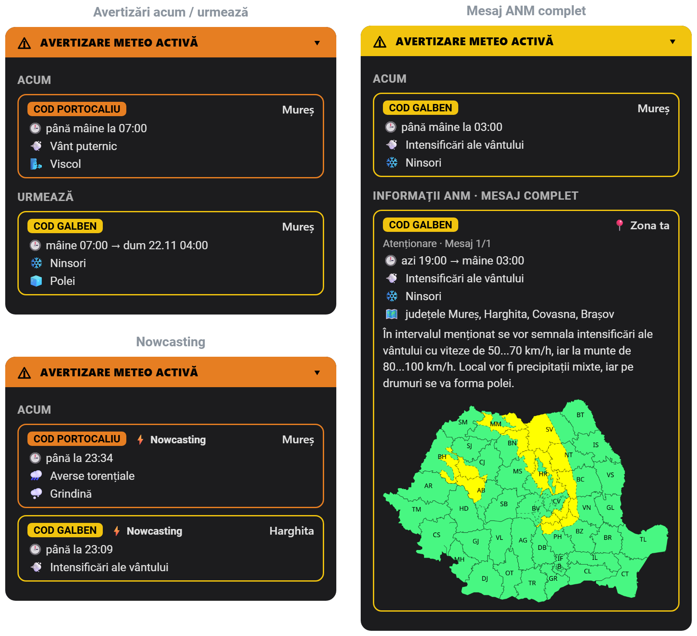

<p align="center">
  
</p>

<h1 align="center">⛈️ Alerte Meteo România</h1>

<p align="center">
  <b>Avertizările ANM și alertele nowcasting, direct în Home Assistant.</b><br>
  🟡 galben · 🟠 portocaliu · 🔴 roșu — pe județ, cu card Lovelace propriu și notificări
</p>

<p align="center">
  <a href="https://hacs.xyz"></a>
  <a href="https://github.com/robex2005/alerte-meteo-ro/actions/workflows/validate.yml"></a>
  <a href="https://github.com/robex2005/alerte-meteo-ro/releases"></a>
  
</p>

<p align="center">
  <a href="#instalare">Instalare</a> ·
  <a href="#configurare">Configurare</a> ·
  <a href="#notificări">Notificări</a> ·
  <a href="#card">Card</a> ·
  <a href="#carduri-manuale-examples">Carduri manuale</a> ·
  <a href="CHANGELOG.md">Istoric</a>
</p>

---

Integrare Home Assistant pentru **avertizările meteo ANM** (pe județ) și **alertele nowcasting**, cu un card Lovelace propriu, care apare în lista de carduri, fără YAML.

<p align="center">
  
</p>

## Ce face

- **Avertizări ANM** pentru un singur județ: cod galben / portocaliu / roșu, *acum* și *urmează* (următoarele 48h), mesajele ANM complete cu harta.
- **Avertizări parțiale** (zone de munte, altitudine, litoral), citite din harta ANM: „📍 Zona ta".
- **Nowcasting** pentru unul sau mai multe județe.
- **Notificări** în aplicația Home Assistant și pe WhatsApp / Telegram (orice serviciu text), fără automatizări: început + încheiere avertizare.
- **Card** `custom:alerte-meteo-card`, compact pe mobil: cod, zonă, oră și fenomene unul sub altul; antet colorat și deschis când e avertizare, „Nicio avertizare meteo" și închis când nu e.

## Instalare

1. HACS → ⋮ → **Custom repositories** → `https://github.com/robex2005/alerte-meteo-ro` → categoria **Integration** → *Add*.
2. Instalează **Alerte Meteo România** și repornește Home Assistant.
3. **Setări → Dispozitive și servicii → Adaugă integrare → Alerte Meteo România.**

Cerințe: Home Assistant **2024.12** sau mai nou, acces la internet (date de la `meteoromania.ro`). Dacă ai integrările vechi `alerta_anm_judet_romania` / `alerta_nowcasting`, șterge-le întâi (entitățile s-ar dubla).

## Configurare

| Câmp | Descriere |
|------|-----------|
| Județ avertizări ANM | **un singur județ** |
| Interval actualizare ANM | minute (implicit 10) |
| Activează alertele nowcasting | pornește senzorii nowcasting |
| Județe nowcasting | **unul sau mai multe**; gol = județul ANM |

Se pot schimba oricând din **Configurare** pe integrare.

## Notificări

Integrarea trimite singură notificări — nu e nevoie de automatizări. Pe integrare → **Configurare**:

| Câmp | Descriere |
|------|-----------|
| Notificări pe telefoanele | unul sau mai multe `mobile_app_*` (aplicația Home Assistant Companion); gol = fără |
| Mesaje text și pe | orice serviciu `notify.*` care trimite doar text: WhatsApp, Telegram, grupuri notify |
| Notifică de la codul | galben (toate) / portocaliu și roșu / doar roșu |
| Notificări pentru avertizările ANM / nowcasting | ce tipuri de alerte se trimit |
| Notificare când avertizarea ANM se încheie | „✅ Alertă Meteo Finalizată" |
| Pagina deschisă la apăsarea notificării | ex. `/lovelace/vreme` |

Pentru telefon: instalează aplicația Home Assistant (Android / iOS) și conectează-o — apare serviciul `notify.mobile_app_<telefon>`. Pentru WhatsApp / Telegram: configurează întâi serviciul `notify` respectiv în Home Assistant, apoi alege-l la *Mesaje text și pe*.

Cum arată (același text în aplicație și pe WhatsApp):

<p align="center">
  
</p>

- câte o notificare pentru fiecare avertizare **nouă** (nu se repetă la restart sau la reîncărcare);
- portocaliu / roșu: sunet critic pe iOS, prioritate mare pe Android (canalul „Alerte meteo");
- notificările aceluiași județ se înlocuiesc una pe alta în aplicație (același `tag`);
- numele județului din titlu/mesaj e mereu cel configurat (ANM) sau cel al alertei (nowcasting).

**Test:** Instrumente pentru dezvoltatori → Acțiuni → `alerte_meteo_ro.test_notificare` — opțional `cod: galben|portocaliu|rosu` și `scenariu: proba|real|doua|nowcasting|final`.

<details>
<summary>Vrei control total? Automatizare manuală (exemplu)</summary>

Lasă câmpurile de notificare goale și folosește senzorul de mesaj al județului tău (`sensor.mesaj_meteo_<judet>`). Numele și codul județului se iau din atributele senzorului (`judet`, `judet_cod`), deci textul e corect pentru orice județ:

```yaml
alias: Notificare avertizare ANM
triggers:
  - trigger: state
    entity_id: sensor.mesaj_meteo_<judet>   # ex. sensor.mesaj_meteo_cluj
    to: alerta
actions:
  - action: notify.mobile_app_<telefon>     # telefonul tău
    data:
      title: >-
        ⚠️ Cod {{ trigger.to_state.attributes.tip_cod }}
        {{ trigger.to_state.attributes.judet | upper }}
      message: "{{ trigger.to_state.attributes.mesaj_complet[:250] }}"
      data:
        url: /lovelace/vreme
        tag: "alerta-meteo-{{ trigger.to_state.attributes.judet_cod | lower }}"
```

</details>

## Card

Dashboard → **Editează** → **Adaugă card** → **Alerte Meteo România**. Se încarcă singur odată cu integrarea; în editor bifezi județele de nowcasting afișate. Avertizările ANM rămân pe județul integrării.

În YAML:

```yaml
type: custom:alerte-meteo-card
judete:            # opțional: județele nowcasting afișate (nume sau cod, cu/fără diacritice)
  - Mureș
  - HR
collapsed: true    # opțional: cardul pornește închis și când e avertizare
```

| Opțiune | Implicit | Descriere |
|---------|----------|-----------|
| `judete` | toate județele nowcasting din integrare | listă de județe (nume sau cod) |
| `collapsed` | `false` | `true` = pornește închis; deschis/închis manual se ține minte în browser |

## Carduri manuale (`examples/`)

Dacă vrei să-ți faci singur cardul, în [`examples/`](examples/) sunt două variante gata de copiat (Dashboard → Adaugă card → Manual):

| Fișier | Necesită | Ce arată |
|--------|----------|----------|
| [`lovelace_card_alerte_meteo.yaml`](examples/lovelace_card_alerte_meteo.yaml) | `custom:button-card` | identic cu cardul integrării (capturile de mai sus), dar ca YAML pe care îl poți modifica |
| [`lovelace_card_markdown.yaml`](examples/lovelace_card_markdown.yaml) | nimic (card Markdown) | listă simplă: avertizări ANM active / viitoare + nowcasting |

Amândouă își găsesc singure județul din integrare — nu trebuie editate. În varianta `button-card`, opțiunile `judete` și `collapsed` sunt în primele rânduri din `label` (`const cfg = …`).

> **Carduri, template-uri sau automatizări scrise de mână:** dacă folosești entități sau coduri de județ scrise manual (ex. `sensor.mesaj_meteo_mures`, `sensor.alerta_nowcasting_mures`, `judet == 'MS'`), schimbă **codul și numele județului peste tot** unde apar, altfel vei vedea datele județului vechi.

## Limite

- Avertizările parțiale se detectează doar cât timp sunt active; pentru cele viitoare ANM nu dă date pe zone.
- Hărțile sunt afișate prin `images.weserv.nl`.
- Serviciile text (WhatsApp etc.) primesc doar text: fără sunet critic, fără link la apăsare.

## Istoric și licență

Versiuni în [CHANGELOG.md](CHANGELOG.md). Licență **GPL-3.0**; provine din unificarea și îmbunătățirea integrărilor [`alerta-anm-judet-romania`](https://github.com/dancucu/alerta-anm-judet-romania) (GPL-3.0) și [`alerta-nowcasting`](https://github.com/dancucu/alerta-nowcasting) (MIT) de `dancucu`. Date: Administrația Națională de Meteorologie.
