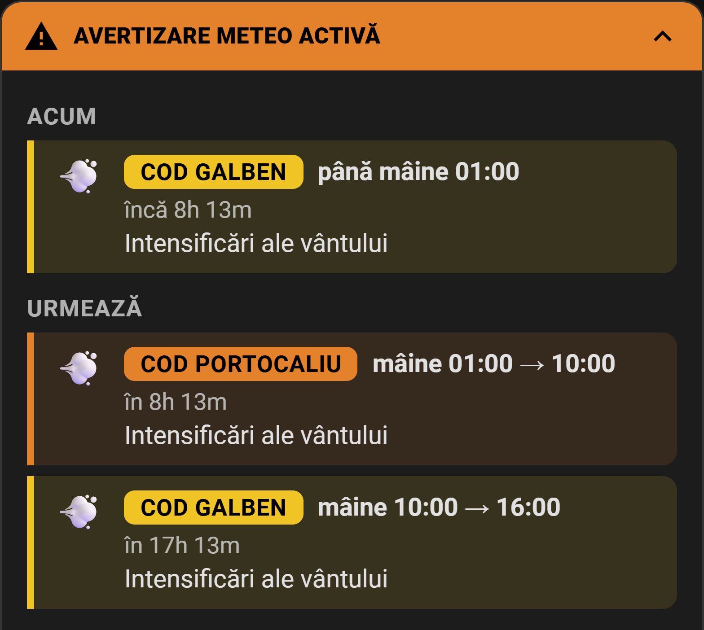
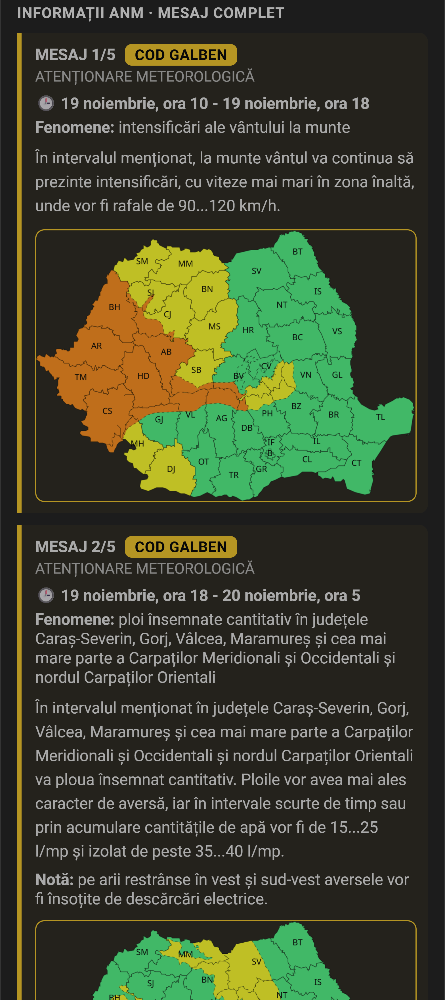

# Alerte Meteo România

Integrare Home Assistant care reunește, într-o singură integrare, două surse oficiale ANM (Meteo România):

- **Avertizări meteo ANM** pe județ: mesajul complet, codul (galben / portocaliu / roșu), harta activă și culoarea județului pe hartă.
- **Alerte nowcasting** (următoarele ore), câte un senzor pentru fiecare județ ales.

Provine din unificarea integrărilor [`alerta-anm-judet-romania`](https://github.com/dancucu/alerta-anm-judet-romania) (GPL-3.0) și [`alerta-nowcasting`](https://github.com/dancucu/alerta-nowcasting) (MIT), de `dancucu`.

## Cerințe (de instalat înainte)

| Ce | Pentru ce | Link |
|----|-----------|------|
| Home Assistant **2024.12** sau mai nou | integrarea (formularul de opțiuni folosește `config_entry` din Home Assistant) | — |
| *(opțional)* **button-card** (`custom:button-card`) | doar pentru varianta YAML [`examples/lovelace_card_alerte_meteo.yaml`](examples/lovelace_card_alerte_meteo.yaml); cardul din integrare nu are nevoie de el | https://github.com/custom-cards/button-card |
| acces la internet | datele vin de la ANM (`meteoromania.ro`); hărțile sunt afișate prin `images.weserv.nl` | — |

Cardul din integrare (`Alerte Meteo România`) nu cere nimic în plus. **button-card** e necesar numai dacă folosești varianta YAML. Cardul Markdown simplu din [`examples/lovelace_card_markdown.yaml`](examples/lovelace_card_markdown.yaml) nu are nevoie de nimic în plus. Alte integrări nu sunt necesare; biblioteca `requests` se instalează automat.

> Dacă ai deja `alerta_anm_judet_romania` sau `alerta_nowcasting`, șterge-le înainte să adaugi această integrare: aceleași entități ar fi create de două ori (cu sufix `_2`).

## Instalare

1. Adaugă acest repository ca *custom repository* în Marketplace/HACS, cu categoria **Integration**, folosind linkul complet:

   ```
   https://github.com/robex2005/alerte-meteo-ro
   ```

   (Marketplace/HACS → meniul ⋮ → *Custom repositories* → lipești linkul → alegi *Integration* → *Add*.)
2. Instalează **Alerte Meteo România** și repornește Home Assistant.
3. **Setări → Dispozitive și servicii → Adaugă integrare → Alerte Meteo România**.

La configurare alegi:

| Câmp | Descriere |
|------|-----------|
| Județ (avertizări ANM) | județul pentru care se afișează mesajul ANM |
| Interval actualizare ANM | în minute (implicit 10) |
| Activează alertele nowcasting | pornește senzorii nowcasting |
| Județe nowcasting | unul sau mai multe județe; gol = județul ales pentru ANM |

Setările se pot schimba ulterior din **Configurare** pe integrare.

## Entități

Pentru județul ales (exemplu: Mureș):

| Entitate | Descriere |
|----------|-----------|
| `sensor.avertizari_meteo_anm` | toate avertizările ANM (atributul `avertizari`) |
| `sensor.anm_avertizare_id` | ID-urile avertizărilor active |
| `sensor.mesaj_meteo_mures` | `alerta` / `liniste`; atribute `tip_cod`, `mesaj_complet` |
| `sensor.harta_meteo_activa` | URL-ul hărții active |
| `sensor.culoare_harta_mures` | culoarea județului pe hartă; atribut `date_harti` |
| `sensor.alerta_nowcasting_mures` | `alerta` / `liniste`; atribute `Alerte active`, `Culoare`, `Început`, `Sfârșit`, `semnalare`, `Zone`, `Fenomene`, `Titlu`, `Ultima actualizare` |

Atributele nowcasting sunt în limba română, cu diacritice; într-un template folosește ghilimele, de exemplu
`state_attr('sensor.alerta_nowcasting_mures', 'Alerte active') | int(0)`.

## Card în dashboard (fără YAML, fără județ scris de mână)

Integrarea își încarcă singură cardul Lovelace. După instalare și repornire:

1. Deschide dashboardul → **Editează** → **Adaugă card**.
2. Caută **Alerte Meteo România** și adaugă-l. Atât.

Cardul își ia județul din integrare (cel ales la configurare) și își găsește singur entitățile; nu trebuie să scrii niciun județ sau nume de entitate. YAML-ul echivalent este doar:

```yaml
type: custom:alerte-meteo-card
```

Județul se poate alege și din editorul vizual al cardului (listă cu numele județelor) sau în YAML, cu nume sau cod, cu sau fără diacritice: `judet: Mureș`, `judet: alba`, `judet: MS`. Avertizările ANM pot fi afișate pentru orice județ; nowcasting apare pentru județele adăugate în integrare. Dacă nu apare în lista de carduri, reîncarcă pagina cu cache-ul șters (Ctrl+F5 / în aplicație: Setări → Aplicație → Șterge cache frontend).

## Carduri Lovelace din exemple (YAML)

Cardurile din [`examples/`](examples/) nu conțin niciun județ scris de mână: își găsesc singure entitățile integrării și iau numele județului din atributul `judet` al lui `sensor.mesaj_meteo_<județ>`. Funcționează pentru orice județ ales la configurare; copiezi YAML-ul în dashboard, fără editări.

| Fișier | Conținut | Necesită |
|--------|----------|----------|
| [`lovelace_card_alerte_meteo.yaml`](examples/lovelace_card_alerte_meteo.yaml) | **cardul principal**: ANM + nowcasting într-un singur card pliabil; *acum* / *urmează* (≤48h), mesajele ANM complete cu hartă | `button-card` |
| [`lovelace_card_markdown.yaml`](examples/lovelace_card_markdown.yaml) | variantă simplă, doar text | cardul Markdown standard |

### Cum arată cardul (telefon)

| Avertizare activă acum + următoarele | Nowcasting activ | Nicio avertizare |
|:---:|:---:|:---:|
|  |  |  |

Mesajele complete ANM, cu harta fiecărui mesaj, apar sub secțiunile *Acum* / *Urmează*:

<p align="center"></p>

Antetul cardului principal se schimbă singur:

- **fără avertizare**: antet neutru „NICIO AVERTIZARE METEO”, card colapsat;
- **cu avertizare** (activă acum, nowcasting sau în următoarele 48h): antet colorat după cea mai gravă avertizare (galben / portocaliu / roșu), „AVERTIZARE METEO ACTIVĂ” și card expandat.

Dacă îl pliezi sau îl expandezi manual, alegerea se păstrează până când starea (avertizare / fără avertizare) se schimbă.

## Licență

GPL-3.0 (vezi `LICENSE`). Partea de nowcasting provine din `alerta-nowcasting`, publicat sub licența MIT, Copyright (c) 2026 Dan.
