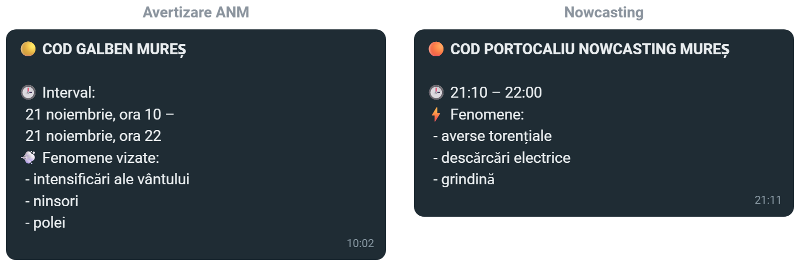

<a id="romana"></a>
<p align="center">
  
</p>

<h1 align="center">⛈️ Alerte Meteo România</h1>

<p align="center">
  <b>Avertizările ANM și alertele nowcasting, direct în Home Assistant.</b><br>
  🟡 galben · 🟠 portocaliu · 🔴 roșu — pe județ, cu card Lovelace propriu și notificări
</p>

<p align="center">
  <a href="#instalare"></a>
  <a href="https://github.com/robex2005/alerte-meteo-ro/actions/workflows/validate.yml"></a>
  <a href="https://github.com/robex2005/alerte-meteo-ro/releases"></a>
  
</p>

<p align="center">
  <a href="#instalare">Instalare</a> ·
  <a href="#configurare">Configurare</a> ·
  <a href="#notificări">Notificări</a> ·
  <a href="#card">Card</a> ·
  <a href="#carduri-manuale-examples">Carduri manuale</a> ·
  <a href="CHANGELOG.md">Istoric</a> ·
  <a href="#english"> English</a>
</p>

---

Integrare Home Assistant pentru **avertizările meteo ANM** (pe județ) și **alertele nowcasting**, cu un card Lovelace propriu, care apare în lista de carduri, fără YAML.

<p align="center">
  
</p>

## Ce face

- **Avertizări ANM** pentru un singur județ: cod galben / portocaliu / roșu, *acum* și *urmează* (următoarele 48h), mesajele ANM complete cu harta.
- **Avertizări parțiale** (zone de munte, altitudine, litoral), citite din harta ANM: „📍 Zona ta".
- **Nowcasting** pentru unul sau mai multe județe.
- **Notificări** în aplicația Home Assistant și pe WhatsApp / Telegram (orice serviciu text), fără automatizări: început + încheiere avertizare.
- **Card** `custom:alerte-meteo-card`, compact pe mobil: cod, zonă, oră și fenomene unul sub altul; antet colorat și deschis când e avertizare, „Nicio avertizare meteo" și închis când nu e.

## Instalare

1. **Marketplace → Adaugă prin link** (sau ⋮ → **Depozite personalizate** → **Adaugă prin link**) → `https://github.com/robex2005/alerte-meteo-ro` → **Adaugă**.
2. Instalează **Alerte Meteo România** și repornește Home Assistant.
3. **Setări → Dispozitive și servicii → Adaugă integrare → Alerte Meteo România.**

Cerințe: Home Assistant **2024.12** sau mai nou, acces la internet (date de la `meteoromania.ro`). Dacă ai integrările vechi `alerta_anm_judet_romania` / `alerta_nowcasting`, șterge-le întâi (entitățile s-ar dubla).

## Configurare

| Câmp | Descriere |
|------|-----------|
| Județ avertizări ANM | **un singur județ** |
| Interval actualizare ANM | minute (implicit 10) |
| Activează alertele nowcasting | pornește senzorii nowcasting |
| Județe nowcasting | **unul sau mai multe**; gol = județul ANM |

Se pot schimba oricând din **Configurare** pe integrare.

## Notificări

Integrarea trimite singură notificări — nu e nevoie de automatizări. Pe integrare → **Configurare**:

| Câmp | Descriere |
|------|-----------|
| Notificări pe telefoanele | unul sau mai multe `mobile_app_*` (aplicația Home Assistant Companion); gol = fără |
| Mesaje text și pe | orice serviciu `notify.*` care trimite doar text: WhatsApp, Telegram, grupuri notify |
| Notifică de la codul | galben (toate) / portocaliu și roșu / doar roșu |
| Notificări pentru avertizările ANM / nowcasting | ce tipuri de alerte se trimit |
| Notificare când avertizarea ANM se încheie | „✅ Alertă Meteo Finalizată" |
| Pagina deschisă la apăsarea notificării | ex. `/lovelace/vreme` |

Pentru telefon: instalează aplicația Home Assistant (Android / iOS) și conectează-o — apare serviciul `notify.mobile_app_<telefon>`. Pentru WhatsApp / Telegram: configurează întâi serviciul `notify` respectiv în Home Assistant, apoi alege-l la *Mesaje text și pe*.

Cum arată (același text în aplicație și pe WhatsApp):

<p align="center">
  
</p>

- câte o notificare pentru fiecare avertizare **nouă** (nu se repetă la restart sau la reîncărcare);
- portocaliu / roșu: sunet critic pe iOS, prioritate mare pe Android (canalul „Alerte meteo");
- notificările aceluiași județ se înlocuiesc una pe alta în aplicație (același `tag`);
- numele județului din titlu/mesaj e mereu cel configurat (ANM) sau cel al alertei (nowcasting).

**Test:** Instrumente pentru dezvoltatori → Acțiuni → `alerte_meteo_ro.test_notificare` — opțional `cod: galben|portocaliu|rosu` și `scenariu: proba|real|doua|nowcasting|final`.

<details>
<summary>Vrei control total? Automatizare manuală (exemplu)</summary>

Lasă câmpurile de notificare goale și folosește senzorul de mesaj al județului tău (`sensor.mesaj_meteo_<judet>`). Numele și codul județului se iau din atributele senzorului (`judet`, `judet_cod`), deci textul e corect pentru orice județ:

```yaml
alias: Notificare avertizare ANM
triggers:
  - trigger: state
    entity_id: sensor.mesaj_meteo_<judet>   # ex. sensor.mesaj_meteo_cluj
    to: alerta
actions:
  - action: notify.mobile_app_<telefon>     # telefonul tău
    data:
      title: >-
        ⚠️ Cod {{ trigger.to_state.attributes.tip_cod }}
        {{ trigger.to_state.attributes.judet | upper }}
      message: "{{ trigger.to_state.attributes.mesaj_complet[:250] }}"
      data:
        url: /lovelace/vreme
        tag: "alerta-meteo-{{ trigger.to_state.attributes.judet_cod | lower }}"
```

</details>

## Card

Dashboard → **Editează** → **Adaugă card** → **Alerte Meteo România**. Se încarcă singur odată cu integrarea; în editor bifezi județele de nowcasting afișate. Avertizările ANM rămân pe județul integrării.

În YAML:

```yaml
type: custom:alerte-meteo-card
judete:            # opțional: județele nowcasting afișate (nume sau cod, cu/fără diacritice)
  - Mureș
  - HR
collapsed: true    # opțional: cardul pornește închis și când e avertizare
```

| Opțiune | Implicit | Descriere |
|---------|----------|-----------|
| `judete` | toate județele nowcasting din integrare | listă de județe (nume sau cod) |
| `collapsed` | `false` | `true` = pornește închis; deschis/închis manual se ține minte în browser |

## Carduri manuale (`examples/`)

Dacă vrei să-ți faci singur cardul, în [`examples/`](examples/) sunt două variante gata de copiat (Dashboard → Adaugă card → Manual):

| Fișier | Necesită | Ce arată |
|--------|----------|----------|
| [`lovelace_card_alerte_meteo.yaml`](examples/lovelace_card_alerte_meteo.yaml) | `custom:button-card` | identic cu cardul integrării (capturile de mai sus), dar ca YAML pe care îl poți modifica |
| [`lovelace_card_markdown.yaml`](examples/lovelace_card_markdown.yaml) | nimic (card Markdown) | listă simplă: avertizări ANM active / viitoare + nowcasting |

Amândouă își găsesc singure județul din integrare — nu trebuie editate. În varianta `button-card`, opțiunile `judete` și `collapsed` sunt în primele rânduri din `label` (`const cfg = …`).

> **Carduri, template-uri sau automatizări scrise de mână:** dacă folosești entități sau coduri de județ scrise manual (ex. `sensor.mesaj_meteo_mures`, `sensor.alerta_nowcasting_mures`, `judet == 'MS'`), schimbă **codul și numele județului peste tot** unde apar, altfel vei vedea datele județului vechi.

## Limite

- Avertizările parțiale se detectează doar cât timp sunt active; pentru cele viitoare ANM nu dă date pe zone.
- Hărțile sunt afișate prin `images.weserv.nl`.
- Serviciile text (WhatsApp etc.) primesc doar text: fără sunet critic, fără link la apăsare.

## Istoric și licență

Versiuni în [CHANGELOG.md](CHANGELOG.md). Licență **GPL-3.0**; provine din unificarea și îmbunătățirea integrărilor [`alerta-anm-judet-romania`](https://github.com/dancucu/alerta-anm-judet-romania) (GPL-3.0) și [`alerta-nowcasting`](https://github.com/dancucu/alerta-nowcasting) (MIT) de `dancucu`. Date: Administrația Națională de Meteorologie.

---

<a id="english"></a>

## 🇬🇧 English

<p align="center">
  <a href="#installation">Installation</a> ·
  <a href="#configuration">Configuration</a> ·
  <a href="#notifications">Notifications</a> ·
  <a href="#card-1">Card</a> ·
  <a href="#manual-cards-examples">Manual cards</a> ·
  <a href="#romana"> Română ↑</a>
</p>

**Romanian ANM weather warnings and nowcasting alerts, right in Home Assistant** — 🟡 yellow · 🟠 orange · 🔴 red, per county, with its own Lovelace card and notifications.

Home Assistant integration for **ANM weather warnings** (per county; ANM is Romania's National Meteorological Administration) and **nowcasting alerts**, with its own Lovelace card that shows up in the card picker, no YAML needed.

> The data comes from ANM in Romanian, so warning texts, phenomena and notifications are in Romanian.

### What it does

- **ANM warnings** for a single county: yellow / orange / red level, *now* and *next* (the next 48h), full ANM messages with the map.
- **Partial warnings** (mountain areas, altitude, seaside), read from the ANM map: "📍 Zona ta" (your area).
- **Nowcasting** for one or more counties.
- **Notifications** in the Home Assistant app and on WhatsApp / Telegram (any text service), no automations needed: warning start + end.
- **Card** `custom:alerte-meteo-card`, compact on mobile: level, area, time and phenomena one below the other; colored, expanded header when there is a warning, "Nicio avertizare meteo" (no weather warning) and collapsed when there isn't.

### Installation

1. **Marketplace → Add via link** (or ⋮ → **Custom repositories** → **Add via link**) → `https://github.com/robex2005/alerte-meteo-ro` → **Add**.
2. Install **Alerte Meteo România** and restart Home Assistant.
3. **Settings → Devices & services → Add integration → Alerte Meteo România.**

Requirements: Home Assistant **2024.12** or newer, internet access (data from `meteoromania.ro`). If you have the old `alerta_anm_judet_romania` / `alerta_nowcasting` integrations, remove them first (the entities would be duplicated).

### Configuration

| Field | Description |
|-------|-------------|
| ANM warnings county | **a single county** |
| ANM update interval | minutes (default 10) |
| Enable nowcasting alerts | turns on the nowcasting sensors |
| Nowcasting counties | **one or more**; empty = the ANM county |

You can change them at any time from **Configure** on the integration.

### Notifications

The integration sends notifications on its own — no automations needed. On the integration → **Configure**:

| Field | Description |
|-------|-------------|
| Notify these phones | one or more `mobile_app_*` (Home Assistant Companion app); empty = none |
| Also send text messages to | any `notify.*` service that only sends text: WhatsApp, Telegram, notify groups |
| Notify from level | yellow (all) / orange and red / red only |
| Notify ANM warnings / nowcasting alerts | which alert types are sent |
| Notify when the ANM warning ends | "✅ Alertă Meteo Finalizată" (weather alert ended) |
| Page opened when tapping the notification | e.g. `/lovelace/vreme` |

For phones: install the Home Assistant app (Android / iOS) and connect it — the `notify.mobile_app_<phone>` service appears. For WhatsApp / Telegram: first set up the matching `notify` service in Home Assistant, then pick it under *Also send text messages to*.

- one notification for each **new** warning (not repeated on restart or reload);
- orange / red: critical sound on iOS, high priority on Android (channel "Alerte meteo");
- notifications for the same county replace each other in the app (same `tag`);
- the county name in the title/message is always the configured one (ANM) or the alert's own (nowcasting).

**Test:** Developer tools → Actions → `alerte_meteo_ro.test_notificare` — optional `cod: galben|portocaliu|rosu` (yellow|orange|red) and `scenariu: proba|real|doua|nowcasting|final` (sample|real|two|nowcasting|end).

<details>
<summary>Want full control? Manual automation (example)</summary>

Leave the notification fields empty and use your county's message sensor (`sensor.mesaj_meteo_<county>`). The county name and code come from the sensor attributes (`judet`, `judet_cod`), so the text is right for any county:

```yaml
alias: ANM warning notification
triggers:
  - trigger: state
    entity_id: sensor.mesaj_meteo_<county>   # e.g. sensor.mesaj_meteo_cluj
    to: alerta
actions:
  - action: notify.mobile_app_<phone>        # your phone
    data:
      title: >-
        ⚠️ Cod {{ trigger.to_state.attributes.tip_cod }}
        {{ trigger.to_state.attributes.judet | upper }}
      message: "{{ trigger.to_state.attributes.mesaj_complet[:250] }}"
      data:
        url: /lovelace/vreme
        tag: "alerta-meteo-{{ trigger.to_state.attributes.judet_cod | lower }}"
```

</details>

### Card

Dashboard → **Edit** → **Add card** → **Alerte Meteo România**. It loads automatically with the integration; in the editor you tick which nowcasting counties to show. ANM warnings always follow the integration's county.

In YAML:

```yaml
type: custom:alerte-meteo-card
judete:            # optional: nowcasting counties to show (name or code, with/without diacritics)
  - Mureș
  - HR
collapsed: true    # optional: the card starts collapsed even when there is a warning
```

| Option | Default | Description |
|--------|---------|-------------|
| `judete` | all nowcasting counties in the integration | list of counties (name or code) |
| `collapsed` | `false` | `true` = starts collapsed; manual open/close is remembered in the browser |

### Manual cards (`examples/`)

If you'd rather build the card yourself, [`examples/`](examples/) has two ready-to-copy versions (Dashboard → Add card → Manual):

| File | Requires | Shows |
|------|----------|-------|
| [`lovelace_card_alerte_meteo.yaml`](examples/lovelace_card_alerte_meteo.yaml) | `custom:button-card` | same as the integration's card (screenshots above), but as YAML you can edit |
| [`lovelace_card_markdown.yaml`](examples/lovelace_card_markdown.yaml) | nothing (Markdown card) | simple list: active / upcoming ANM warnings + nowcasting |

Both find the integration's county on their own — no editing needed. In the `button-card` version, the `judete` and `collapsed` options are in the first lines of `label` (`const cfg = …`).

> **Hand-written cards, templates or automations:** if you use hard-coded entities or county codes (e.g. `sensor.mesaj_meteo_mures`, `sensor.alerta_nowcasting_mures`, `judet == 'MS'`), change **the county code and name everywhere** they appear, otherwise you will see the old county's data.

### Limitations

- Partial warnings are only detected while they are active; ANM gives no per-area data for upcoming ones.
- Maps are shown through `images.weserv.nl`.
- Text services (WhatsApp etc.) only get text: no critical sound, no tap link.

### Changelog and license

Versions in [CHANGELOG.md](CHANGELOG.md) (in Romanian). License **GPL-3.0**; it merges and improves the [`alerta-anm-judet-romania`](https://github.com/dancucu/alerta-anm-judet-romania) (GPL-3.0) and [`alerta-nowcasting`](https://github.com/dancucu/alerta-nowcasting) (MIT) integrations by `dancucu`. Data: Administrația Națională de Meteorologie (ANM).
